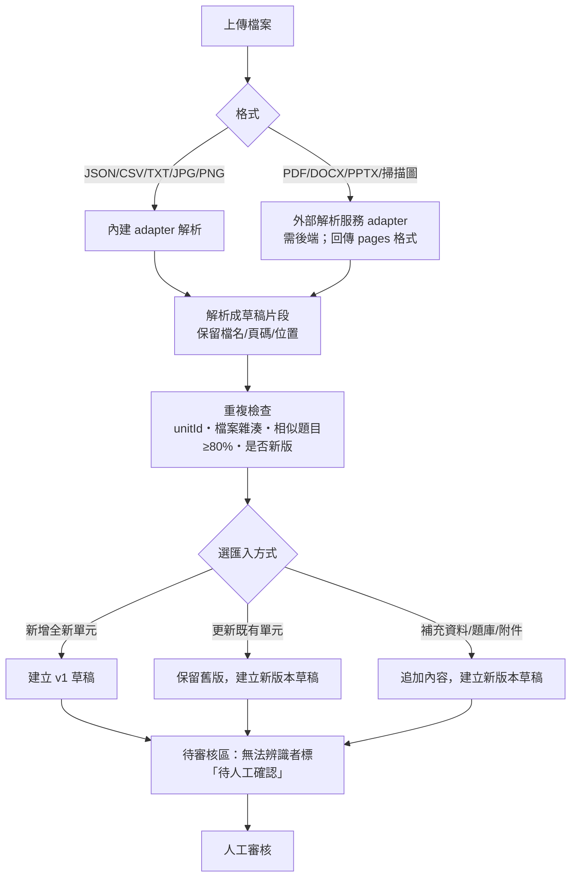
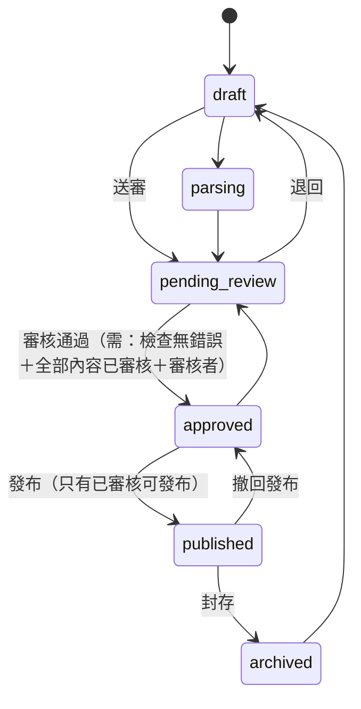

# 教材中央資料庫與批次匯入系統：第一階段架構規劃

> 狀態：**規劃與原型，等待你確認後才進入實際開發。** 本次沒有修改任何原有教材、題庫、PDF、網址或 localStorage，也沒有推送到 GitHub。
> 原型：`content-manager.html`（本機操作，不連網，不含任何 API 金鑰）。Schema：`content/schema/`。

---

## 1. 現有教材資料盤點（實際計數，來源：GitHub `main`）

### 1.1 目前教材「活」在哪裡
| 位置 | 內容 | 資料形態 | 備註 |
|---|---|---|---|
| 6 個學習島頁面 | G5 國語／數學／社會／自然、G6 自然／社會 | 每頁一個 `var L=[…]`，寫死在 HTML 內 | 各 9～10 個節點、29～36 張卡片；圖解（SVG）與照片也在頁內 |
| `index.html` 刷題系統 | **1,479 題**、43 個單元（u=1～43） | `mc()／tf()／fill()／match()／order()／sorting()` 函式呼叫，在 IIFE 內 | 題型：選擇 865、是非 278、填充 172、配合 65、分類 53、排序 46；外部無法直接讀取 |
| `science/data/*.js` | 自然科 4 個互動單元 | JS 模組（本專案新建，結構已接近新 Schema） | 120 題、58 個知識標籤、13 個互動實驗 |
| `pdf/` | 152 個 PDF（約 56 MB） | 檔案 | 考卷與答案；網址已被各頁引用 |
| `img/` | 110 張圖（約 12 MB） | 檔案 | `chi5/`、`nat5/`、`soc5/` |
| `adventure/data.js` | 3D 島的科目、建築、連結 | JS 模組 | **科目與連結寫死**（新增科目要改這裡） |
| `localStorage` | 學生進度 | 8 個 key | `sci6-quest-v1`、6 個 `island-*-v1`、`adv-sci-v1` |

學習島頁面單元數量（節點／卡片）：G5 國語 9／36、G5 數學 9／30、G5 社會 9／29、G5 自然 9／28、G6 自然 9／31、G6 社會 10／29。

### 1.2 盤點結論（影響設計的重點）
1. **教材分散在三種形態**（頁內 JS、IIFE 內函式呼叫、`science/data`），沒有統一識別碼。→ 需要 `unitId` 與轉接器，不能靠搬資料。
2. **刷題題庫無法外部讀取**（在 IIFE 內）。→ 新系統不複製、不覆蓋，只用 `legacyRef` 指向；要共用需另做唯讀匯出（Phase 2 評估）。
3. **3D 島的科目與連結寫死**。→ 要達成「新增單元不改 3D 程式」，必須讓 3D 島改讀 manifest（有相容方案，見 §8）。
4. 原系統**沒有標明課本版本**，本規格要求的 `textbookVersion` 先填「未標示」，不猜。
5. 我已用管理中心把 **4 個既有互動單元轉成新格式**，4 個都通過 Schema（0 錯誤、0 警告），證明新格式足以容納現有教材。

---

## 2. 教材中央資料庫架構

### 2.1 分層
```
 ┌────────────── 學生端（GitHub Pages，靜態）──────────────┐
 │ 3D 冒險島 / 知識教室 / 互動實驗室 / 老師示範 / 闖關 / 測驗 / 小幫手 │
 │              ▲ 只讀 manifest 與單元 JSON（依 unitId）            │
 └──────────────┼──────────────────────────────────────────┘
                │  content/manifest.json   （只列 published）
                │  content/units/<unitId>@v<N>.json  （每版一檔，不覆蓋）
 ┌──────────────┴──── 教材中央資料庫（第一階段：repo 內 JSON）────┐
 │  Schema（unit / manifest）  ・  版本檔  ・  原始檔（pdf/img）     │
 └──────────────▲──────────────────────────────────────────┘
                │ 發布包（人工審核後產生，commit 進 repo）
 ┌──────────────┴──── 管理中心 content-manager.html ───────────┐
 │ 匯入(adapters) → 草稿 → 重複檢查 → 審核 → 版本 → 發布包          │
 │ 本機儲存：adv-cm-v1（只存草稿與版本，不碰學生資料）              │
 └──────────────▲──────────────────────────────────────────┘
                │ 選用：外部解析服務（需後端；金鑰只在後端）
```
**原則**：資料驅動；各模組只用 `unitId` 取教材，不各自保存副本；原有頁面與資料不動，用「轉接器」並存。

### 2.2 識別碼
- `unitId`：`G5-NAT-U01`（年級-科目-單元）；`questionId`：`G5-NAT-U01-Q001`；`knowledgePointId`：`G5-NAT-U01-KP-xx`。
- **questionId 在所有版本間永遠不變**（題目被修改只增加 `revision`），學生的答題紀錄才不會失效。
- 科目代碼可擴充：CHI、MAT、SOC、NAT，未來新增只需在選單加一個代碼，不改程式邏輯。

---

## 3. JSON Schema
- 單元：[`content/schema/unit.schema.json`](../../content/schema/unit.schema.json)（draft-07）。必要欄位完全涵蓋你的規格：unitId、grade、subject、unitNumber、unitTitle、textbookVersion、learningObjectives、sourceFiles、lessons、keyPoints、illustrations、experiments、examples、questions、assessments、explanations、commonMistakes、achievements、reviewStatus、createdAt、updatedAt（另加 `version` 物件記錄版本號、修改摘要、作者、審核者）。
- 發布清單：[`content/schema/manifest.schema.json`](../../content/schema/manifest.schema.json)。
- **題目**：questionId、unitId、knowledgePointId、questionType（mc／tf／match／fill／short）、difficulty、questionText、options、correctAnswer、explanation、sourceFile、sourcePage、reviewStatus（另有 revision、legacyRef）。答案格式依題型：mc＝選項索引、tf＝true/false、fill＝字串陣列、match＝配對陣列、short＝`{reference, keywords}`（簡答需老師評分）。
- **來源保留**：每個內容項都有 `source{fileId, fileName, page, locator, legacyRef}`；圖片有 `bbox`（頁面位置）。
- **單項審核狀態**：`pending｜approved｜rejected｜needs_confirmation`（待人工確認＝解析器無法辨識，不得當成確定內容）。
- **語意檢查**（Schema 無法表達的）：答案索引範圍、題目必須對應到存在的知識點、unitId 與年級科目一致、assessment 的題號必須存在、實驗必須有安全提醒、已審核／已發布的單元不得含未審核項目。

---

## 4. 教材匯入流程

- **格式**：JSON／CSV 題庫／TXT／JPG／PNG 在管理中心內直接解析（已實作並測試）；PDF／DOCX／PPTX 只登記原始檔與雜湊，內容標「待人工確認」，等外部解析服務接上後以標準 `pages` 格式匯入（已實作匯入端）。
- **AI 解析**：必須經後端（見 §9）。解析結果一律進待審核區，**不自動發布**；無法辨識的欄位不補寫成確定答案。
- **原始檔不丟**：`sourceFiles` 記錄檔名、大小、SHA-256、解析器版本與儲存路徑。

---

## 5. content-manager.html 原型（已可操作）
功能：總覽、匯入（檔案→年級/科目/單元/名稱→解析→重複檢查→建立草稿）、預覽（段落／知識點／實驗／題庫表／學生端題目預覽）、審核（Schema＋語意檢查、逐題與批次審核、答案修正、狀態轉換）、版本（版本表、差異摘要、以此為基礎建新版、回復、下載 JSON）、發布（發布包、manifest 預覽與檢查、撤回、封存）、說明。
**限制（原型）**：資料在瀏覽器 localStorage（`adv-cm-v1`）；無登入權限；PDF／DOCX／PPTX／AI 解析未連接；發布＝產生檔案，需人工 commit。

---

## 6. 審核與發布流程

- 只有 `published` 會進 manifest，學生端才看得到；其他狀態一律不顯示，也不會顯示成「已開放」。
- 核准後該版**鎖定**，要修改必須建立新版本。
- 已實測：未審核不能核准；有無效答案即使全部勾選通過也不能核准；跳過狀態被拒絕；撤回發布後 manifest 不含該單元。

---

## 7. 版本管理設計
- 每次更新＝**新增一個版本**（`G5-NAT-U01@v2.json`），舊版永遠保留；版本紀錄：版本號、修改摘要、作者、審核者、審核時間、父版本。
- **回復**＝把 manifest 的 `version` 指回舊版（舊版必須曾審核通過）；不刪除任何版本。
- **不影響學生歷史紀錄**：學習紀錄以 `unitId＋questionId` 為鍵，questionId 不變；紀錄中另存 `unitVersion`（Phase 2 起新增欄位，舊紀錄視為 v1）。被刪除的題目，舊紀錄仍保留但不再列入分析。
- 更新方式五種（新增單元／更新單元／補充資料／題庫／僅圖片附件）已在管理中心實作；題庫匯入會略過與既有題目相似度 ≥80% 者（可人工覆核）。

---

## 8. 原有系統相容方案
**不動的東西**：所有 HTML 教材頁、`index.html`、PDF、`img/`、網址、8 個 localStorage key、`pdf` 路徑、`science/` 現有單元。
**並存方式（Phase 2 實作時）**
1. **Content Loader**（新模組）：先讀 `content/manifest.json`，依 `unitId` 載入單元 JSON；找不到時回退到現有 `science/data`（舊單元仍可用）。
2. **單元 JSON → 現有執行格式**：寫一個「反向轉接器」，讓 `science/app.js` 不需大改（知識教室、實驗、示範、闖關、測驗、小幫手、成果與錯題分析都經由 loader 取得同一份資料）。
3. **3D 島**：`adventure/data.js` 改為「既有設定＋manifest 動態合併」。有 `published` 單元的科目才顯示互動入口；未發布一律不顯示。**不需要改 3D 場景程式**，只改資料來源這一處（唯一需要碰既有檔案的地方，會先備份並可回復）。
4. **既有教材登記**：用 `legacy` 欄位把現有頁面與刷題連結掛到對應 unitId，網址不變。
**風險**：反向轉接器要完整覆蓋各類型（目前只涵蓋自然科互動單元）；國語／數學／社會的學習島頁面為頁內資料，第一階段只做「登記對應」，不轉內容。

---

## 9. 儲存與後端技術建議

### 9.1 GitHub Pages 的限制
靜態網站，**不能**安全接收檔案上傳、執行 AI API（金鑰會暴露）、提供多使用者寫入資料庫，也沒有登入與權限。

### 9.2 方案比較（費用為公開資料，會變動，以官方頁面為準）
| 方案 | 適合 | 免費額度（查證結果） | 付費 | 主要取捨 |
|---|---|---|---|---|
| **A. 靜態 JSON＋本機管理（第一階段）** | 單一管理者、教材量中等 | GitHub Pages 免費 | 0 | 無多人協作與同步；審核靠人工與 git 歷史 |
| **B. Supabase** | 需要登入、權限、多裝置同步、報表 | Free：5 萬 MAU、500 MB 資料庫、1 GB 檔案、5 GB 流量、2 個專案；**閒置 1 週會暫停** | Pro 約 $25／月起（含更高額度；超額另計） | 關聯式資料庫＋Row Level Security 很適合「老師／家長／學生」權限；可用 Edge Function 保管 AI 金鑰 |
| **C. Cloudflare（Workers＋D1＋R2）** | 重視低成本與邊緣部署 | D1 免費：單庫 500 MB、帳號 5 GB；R2 免費額度**我未能從官方確認** | 依用量 | 要自己做登入與權限；後端程式量較多 |
| **D. Firebase** | 行動 App 風格、即時同步 | 有 Spark（免費）與 Blaze（用量計費）；各來源對免費額度與 Storage 是否需 Blaze **說法不一** | 用量計費，較難預估 | NoSQL，做「錯題分析／跨單元報表」較吃力；費用較難預測 |
| E. 自架 VPS | 有維運人力 | — | 主機費＋維運 | 備份、更新、資安都要自己負責，不建議 |

### 9.3 建議
- **第一階段（現在）**：方案 A。JSON＋本機管理中心，審核通過後產生發布包，用 git 提交（git 歷史就是稽核紀錄）。成本 0，且沒有任何金鑰風險。
- **第二階段**：**Supabase**。理由：資料天生是關聯式（單元、題目、版本、學生、答題）；RLS 可直接表達「老師看班級、家長看自己的孩子、管理者審核」；Storage 放原始檔；Edge Function 保管 AI 金鑰並限流。先用 Free 試點，正式使用建議 Pro（避免閒置暫停）。若預算極低且有開發人力，可改 Cloudflare 方案。
- **AI 解析**：永遠在後端（Edge Function／Worker）呼叫；前端只傳檔案給後端。後端要有：登入驗證、檔案大小與頁數上限、每日費用上限、速率限制、紀錄。**費用要用試點估算**：頁數 × 每頁 token（掃描頁以圖片計較貴）× 供應商單價；建議先用 5～10 份實際教材試跑再決定預算，我不在此給未經驗證的單價。
- **需要你先決定的**：課本與考卷是否有**版權**或授權限制（上傳到雲端服務與 AI 前要確認）；學生個資（暱稱、學習紀錄）上雲涉及**個資保護**，多裝置同步前要先設計同意與最小蒐集原則。

---

## 10. 開發階段與測試計畫

| 階段 | 內容 | 驗收 |
|---|---|---|
| **P0（已完成）** | 架構、Schema、管理中心原型、既有 4 單元轉換驗證 | Schema 通過、流程可操作 |
| **P1** | 管理中心正式化：題目／段落編輯器、CSV／JSON 匯入完善、圖片管理、備份還原、發布包驗證 | 單元測試＋手動流程 |
| **P2** | Content Loader＋反向轉接器；science 模組全面改走 unitId；3D 島改讀 manifest（先備份）；舊單元回退 | 新舊單元並存；既有流程零回歸 |
| **P3** | 試點：用真實的新教材（建議六年級國語或數學一單元）走完整匯入→審核→發布 | 老師審核者實測 |
| **P4** | 後端（Supabase）：登入、角色、RLS、檔案儲存、版本與審核紀錄 | 權限測試、備份 |
| **P5** | AI 解析 Edge Function＋外部解析 adapter（PDF／DOCX／PPTX／OCR） | 準確率抽測、費用上限 |
| **P6** | 多裝置同步與家長／老師正式查看 | 個資與權限檢查 |

**測試計畫**
1. Schema／語意：所有單元通過；故意壞資料必須被擋（已做負向測試）。
2. **保護回歸**（每階段）：93 個受保護檔案雜湊不變、全站 1,479 題、自然科 309 題來源行相同、所有 PDF 連結 200、8 個 localStorage key 內容逐位元相同。
3. 流程：匯入各格式、重複偵測、狀態機非法轉換、審核閘門、版本與回復、撤回、發布包 manifest 驗證。
4. 學生端：未發布的單元**不得**出現；發布後自動出現；撤回後消失；歷史紀錄保留。
5. 安全：全專案掃描無金鑰；前端只連同網站與自家後端；管理頁在正式環境需登入（P4 起）。
6. 真機與瀏覽器：手機、iPad、Safari。

---

## 11. 本次原型的實測結果
- 既有 4 個互動單元轉成新格式：**Schema 0 錯誤、語意 0 錯誤**；負向測試（錯誤 unitId、非法題型、缺欄位、多餘欄位、答案越界）全部被擋。
- 匯入 CSV（選擇／是非／填充／配合／簡答五種題型）、TXT、PNG、PDF（登記）：解析正確；答案找不到的題目標為「待人工確認」；與既有題庫相同的題目被偵測為重複（相似度 100%）；同批重複檔案被略過。
- 審核與發布：未全部審核不能核准；無效答案擋下發布；核准後鎖定；跳過狀態被拒絕。
- 版本：建立 v2 後 v1 保留；回復到曾審核的 v1 成功；回復到從未審核的版本被拒絕；撤回發布與封存後 manifest 不含該單元；發布包與 manifest 通過 Schema。
- 管理中心**只寫入 `adv-cm-v1`**，學生端 8 個 key 完全未動。

## 12. 尚未驗證／不確定
- 真機（手機、iPad、Safari）操作；大型單元（上千題）的效能。
- PDF／DOCX／PPTX／OCR／AI 解析都沒有接上，沒有解析準確率資料。
- 後端費用只依公開資料，各來源有分歧，上線前請以官方定價與實際試點為準。
- 反向轉接器與 3D 島改讀 manifest 尚未實作（要等你確認後再做，並先備份）。

## 13. 需要你確認的事
1. 是否同意 **第一階段用「靜態 JSON＋本機管理中心」**，第二階段再上 Supabase？
2. 試點教材要選哪一科？（建議六年級國語或數學一個單元，會牽涉不同題型）
3. 課本與考卷的**版權／授權**是否允許上傳到雲端與 AI 服務？
4. 誰負責**審核**？審核者是否需要分級（老師審核、管理者發布）？
5. 新增年級或科目時的**代碼命名**是否照 `G?-科目-U??`？

---
**資料來源（費用查證，皆為第三方與官方混合，請以官方最新頁面為準）**
- Supabase 定價整理：[Jetadmin](https://www.jetadmin.io/blog/supabase-pricing-2026-guide-to-plans-limits-and-real-world-costs/)、[官方定價頁](https://supabase.com/pricing)
- Cloudflare D1：[官方 D1 文件](https://developers.cloudflare.com/d1/reference/faq)
- Firebase：[官方方案說明](https://firebase.google.com/docs/projects/billing/firebase-pricing-plans?hl=sr)
